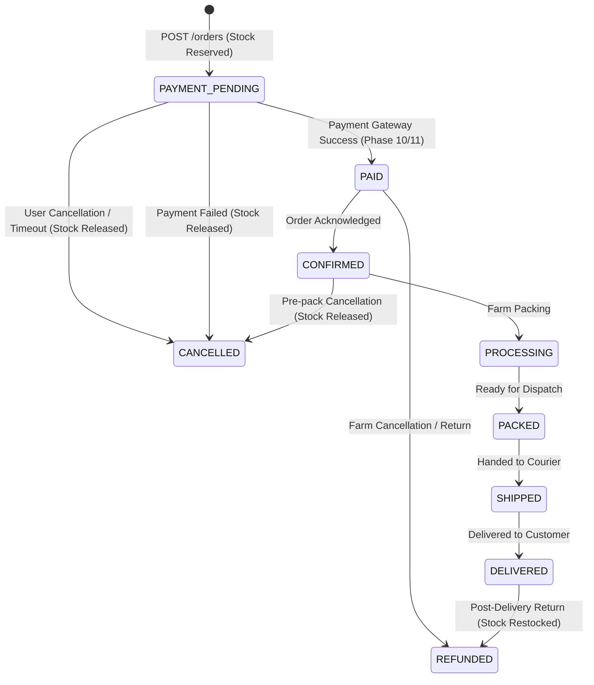

# MushBio Order Lifecycle & State Machine Architecture (Phase 08)

---

## 1. Overview & Core Principles

The MushBio order engine manages authoritative order creation, atomic stock reservations, immutable historical snapshots, customer order retrieval, and state transitions:

1. **Zero Client Trust**: All subtotals, shipping costs, taxes, line totals, and order statuses are strictly calculated by Cloud Functions v2.
2. **Atomic Inventory Reservation**: During order creation, stock is reserved using Firestore transactions (`inventoryService.reserveStock()`). If any item in the order has insufficient stock, the entire order fails and all partial reservations are rolled back via Saga compensation (`inventoryService.releaseReservation()`).
3. **Idempotency Protection**: Supports standard `Idempotency-Key` headers. Duplicate requests return the previously created order without double-reserving inventory. Reusing a key with different checkout payload is rejected with `409 IDEMPOTENCY_KEY_REUSE`.
4. **Immutable Snapshots**: Order items and shipping address details are stored as immutable snapshots in `orders/{orderId}/items/{itemId}` and `orders/{orderId}.shippingAddressSnapshot`. Future catalog price changes or address book edits never alter historical records.
5. **Clean Cart Conversion**: Upon successful order creation, the user's active cart is converted to `status: "CONVERTED"`.

---

## 2. Order Endpoints

| Method | Endpoint | Description | Auth Requirement |
|---|---|---|---|
| **POST** | `/api/v1/orders` | Creates an order from active cart, reserves inventory, and locks pricing. | `requireAuth()`, `requireActiveAccount()` |
| **GET** | `/api/v1/orders` | Lists authenticated customer orders with cursor pagination. | `requireAuth()`, `requireActiveAccount()` |
| **GET** | `/api/v1/orders/:orderId` | Retrieves order detail with ownership guard (`userId == request.auth.uid`). | `requireAuth()`, `requireActiveAccount()` |
| **POST** | `/api/v1/orders/:orderId/cancel` | Customer cancels their pending order; automatically releases reserved inventory. | `requireAuth()`, `requireActiveAccount()` |

---

## 3. Order State Machine Transitions

---

## 4. Human-Facing Order Number Format

All orders receive a Crockford Base32 human-friendly identifier:
- Pattern: `MB-YYYY-XXXXXX`
- Example: `MB-2026-7K4M9Q`
- Characters: Digits `2-9` and Uppercase Letters excluding ambiguous glyphs (`I`, `L`, `O`, `0`, `1`).

---

## 5. Security Rules Integration

Orders are protected under `firestore.rules`:
- Direct client writes (`create`, `update`, `delete`) are **completely disabled** (`allow write: if false`).
- Direct client reads (`get`, `list`) are strictly restricted to the order owner (`resource.data.userId == request.auth.uid`) or staff/admin tokens.
